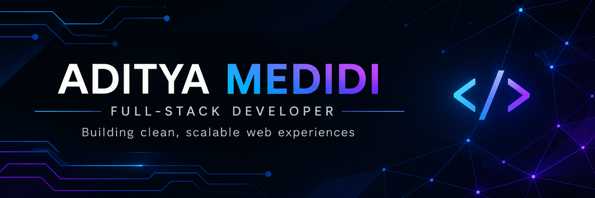

# ADITYA MEDIDI

### Full-Stack Developer

**React.js | JavaScript | Node.js | Java | SQL**

Building practical applications. Learning continuously. Solving real problems.

---

## 👨‍💻 About Me

I'm a software developer passionate about building useful applications and solving real-world problems.

- Interested in full-stack web development.
- Working with React.js and JavaScript.
- Exploring backend development with Node.js and Java.
- Interested in database design and management.
- Enjoy debugging and solving technical challenges.
- Always learning and improving my development skills.
- Open to software development opportunities.

---

## 🛠️ Technical Skills

| Category | Technologies |
|---|---|
| Frontend | HTML, CSS, JavaScript, React.js |
| Backend | Node.js, Express.js, Java, Spring Boot |
| Database | MongoDB, MySQL, PostgreSQL |
| Tools | Git, GitHub, VS Code, Postman |

---

## 🚀 Featured Projects

### 1. AI Review Engine

AI-focused code review project.

[View Project](https://github.com/adityamedidi/ai-review-engine)

### 2. Netflix Clone

Streaming-platform-inspired frontend project.

[View Project](https://github.com/adityamedidi/netflix-clone)

### 3. Hospital Management SQL

Database-focused hospital management project.

[View Project](https://github.com/adityamedidi/hospital-management-sql)

### 4. LiveBid

Live bidding application project.

[Explore All Projects](https://github.com/adityamedidi?tab=repositories)

---

## 📊 GitHub Dashboard

**My GitHub Profile**

[View my repositories](https://github.com/adityamedidi?tab=repositories)

[View my contributions](https://github.com/adityamedidi?tab=overview)

---

## 🎯 Current Goals

- Build practical full-stack applications.
- Improve Java and backend development.
- Strengthen problem-solving skills.
- Learn system design and software architecture.
- Write clean and maintainable code.

---

## 🤝 Connect With Me

**Open to collaboration and software development opportunities.**

### Thanks for visiting my profile! ⭐

